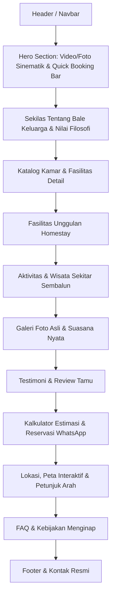

# Product Requirement Document (PRD)
## Landing Page: Bale Keluarga Homestay Sembalun

---

### 1. Ringkasan Eksekutif & Visi Produk
* **Nama Properti**: Bale Keluarga Homestay Sembalun
* **Lokasi**: Lembah Sembalun, Lombok Timur, Nusa Tenggara Barat (kaki Gunung Rinjani)
* **Visi**: Menjadi pilihan utama homestay keluarga, pendaki, dan wisatawan di Sembalun yang menghadirkan kehangatan rumah ("Bale"), kenyamanan modern di tengah sejuknya hawa pegunungan, serta kemudahan akses wisata Rinjani.
* **Tujuan Landing Page**: 
  1. Menampilkan profil lengkap, fasilitas, tipe kamar, dan keasrian homestay secara visual dan memikat (*high-converting visual storytelling*).
  2. Membangun kepercayaan calon tamu (*trust & social proof*) melalui ulasan, transparansi harga, dan sertifikasi/legalitas.
  3. Mengakselerasi konversi pemesanan langsung (*Direct Booking*) melalui integrasi instan ke WhatsApp dan formulir reservasi interaktif tanpa potongan komisi OTA.

---

### 2. Target Audiens & Persona Pengguna

| Persona | Profil & Karakteristik | Kebutuhan Utama |
| :--- | :--- | :--- |
| **Keluarga Berlibur (*Family Vacation*)** | Orang tua dengan anak atau rombongan keluarga besar yang ingin *healing* di suasana sejuk Sembalun. | Kamar luas (*family room*), air panas (*water heater* mutlak), area bermain/kebun stroberi, parkir mobil aman, suasana tenang dan higienis. |
| **Pendaki Rinjani (*Hikers & Adventurers*)** | Pendaki lokal/internasional yang transit sebelum atau sesudah ekspedisi Gunung Rinjani / Bukit Pergasingan. | Tempat istirahat yang nyaman, sewa alat camping/porter, sarapan pagi-pagi, penitipan barang, info trek terkini. |
| **Pasangan & Solo Traveler (*Couples & Digital Nomads*)** | Pasangan muda atau pekerja remote mencari pemandangan indah dan ketenangan. | Pemandangan langsung ke Gunung Rinjani/bukit (*mountain view*), Wi-Fi stabil, spot kopi/balkon estetik, suasana romantis & privat. |

---

### 3. Nilai Jual Unik (*Unique Value Proposition* / UVP)
1. **Kehangatan Keramahan Sasak ("Bale")**: Konsep kekeluargaan asli lokal, tamu diperlakukan seperti keluarga sendiri, lengkap dengan teh/kopi Sembalun gratis saat kedatangan.
2. **Pemandangan 360° Menawan**: Lanskap langsung menghadap Gunung Rinjani dan Bukit Pergasingan tanpa terhalang gedung tinggi.
3. **Fasilitas Hangat di Hawa Dingin**: *Water heater* bertekanan stabil di setiap kamar mandi, selimut termal tebal, dan *bonfire area* (api unggun malam hari).
4. **Wisata Terintegrasi**: Tersedia layanan paket sunrise Pergasingan, petik stroberi di kebun samping homestay, dan sewa motor.

---

### 4. Struktur Halaman & Fitur Profil Lengkap

Landing page akan dirancang dengan navigasi *single-page application* (SPA) responsif yang mulus dengan *anchor scrolling*:

#### 4.1. Fitur Utama & Rincian Konten

##### A. Hero Section (First Impression)
* **Visual**: Foto/slider panorama megah Gunung Rinjani di pagi hari dengan latar bangunan homestay bernuansa asri.
* **Headline**: *"Kehangatan Rumah Keluarga di Bawah Kaki Gunung Rinjani"*.
* **Subheadline**: *"Nikmati sejuknya Sembalun dengan kenyamanan kamar hangat, pemandangan bukit memukau, dan keramahan khas Lombok."*
* **Quick Availability Check**: Input tanggal check-in, check-out, jumlah tamu, dan tombol CTA *"Cek Ketersediaan Kamar"*.
* **Badges**: *"⭐ 4.9/5 Rating Tamu"*, *"Water Heater Tersedia"*, *"Pemandangan Rinjani Langsung"*.

##### B. Profil Lengkap Homestay (*About Us & Story*)
* Deskripsi sejarah dan konsep "Bale Keluarga": komitmen menjaga kenyamanan serasa di rumah sendiri.
* Keunggulan lokasi strategis: hanya 5 menit ke Bukit Pergasingan, 10 menit ke Desa Adat Beleq, dan dekat jalur pendakian Sembalun.
* Komitmen kebersihan & keramahan staf lokal.

##### C. Showcase Tipe Kamar (*Room Showcase & Pricing*)
Menampilkan kartu kamar interaktif dengan galeri foto, spesifikasi, dan tombol booking cepat:
1. **Deluxe Rinjani View Room**
   * *Kapasitas*: 2 Dewasa (+ 1 Anak)
   * *Fitur*: King Bed, Balkon Pribadi menghadap Rinjani, Smart TV, Water Heater, Meja Kerja, Teko Listrik, Sarapan 2 Porsi.
2. **Family Suite Bale**
   * *Kapasitas*: 4–6 Orang
   * *Fitur*: 2 Queen Beds / Mezzanine Style, Ruang Santai Mini, Water Heater, Dispenser Air, Balkon Kebun.
3. **Standard Cozy Room**
   * *Kapasitas*: 2 Orang
   * *Fitur*: Queen Bed, Kamar Mandi Dalam + Water Heater, Wi-Fi Kencang, Cocok untuk transit pendaki.
* **Fitur Interaktif Kamar**: Modal pop-up detail fasilitas, foto 360°/multi-angle, serta rincian harga per malam yang transparan.

##### D. Fasilitas Lengkap (*Homestay Amenities*)
* **Kenyamanan Kamar**: *Hot Water Shower* (paling dicari di Sembalun yang suhunya bisa mencapai 12°C di malam hari), selimut *duvet* tebal, handuk bersih, sabun/sampo aromaterapi.
* **Fasilitas Umum**:
  * *High-Speed Wi-Fi* (Starlink / Fiber Optic untuk pendaki atau pekerja jarak jauh).
  * Area Santai & Bale Bengong (gazebo tradisional Sasak).
  * Area Api Unggun (*Bonfire*) & Alat BBQ untuk kumpul malam hari.
  * Dapur Bersama (*Shared Kitchen*) lengkap dengan kulkas, kompor, dan alat masak.
  * Lahan Parkir Luas (muat hingga 6 mobil dan 15 motor).
  * Kebun Stroberi & Sayur Organik pribadi yang bisa dipetik tamu.

##### E. Pengalaman & Paket Wisata (*Local Experiences*)
* **Paket Sunrise Bukit Pergasingan**: Guide lokal, tiket masuk, dan sarapan di puncak bukit.
* **Wisata Edukasi Kebun Stroberi & Sayur**: Tiket masuk dan wadah petik sendiri.
* **Layanan Pendakian Rinjani**: Penyewaan tenda, sleeping bag kualitas dingin, matras tebal, dan koneksi porter terpercaya.
* **Sewa Motor Sembalun**: Motor matic prima untuk keliling desa dan Bukit Selong.

##### F. Galeri Visual (*Photo Showcase*)
* Kategori filter tab: *Semua*, *Kamar*, *Pemandangan*, *Fasilitas*, *Momen Tamu*.
* Efek lightbox saat diklik dengan resolusi tinggi.

##### G. Ulasan Tamu & Bukti Sosial (*Guest Reviews & Ratings*)
* Menampilkan ulasan autentik dari tamu keluarga, wisatawan asing, dan rombongan komunitas pendaki.
* Badge rating terverifikasi (Google Maps 4.9/5).

##### H. Fitur Kalkulator Biaya & Pemesanan WhatsApp Otomatis
* Calon tamu dapat memilih:
  1. Tipe Kamar
  2. Tanggal Menginap & Durasi Malam
  3. Jumlah Tamu
  4. Tambahan Layanan (contoh: Sewa Motor, Paket Sunrise, BBQ Set)
* Sistem otomatis menghitung estimasi total biaya dan menyusun teks pesan WhatsApp rapi (*pre-formatted message*), contoh:
  > *"Halo Bale Keluarga Homestay Sembalun, saya mau reservasi kamar [Deluxe Rinjani View] untuk tanggal [15 Nov 2026] - [17 Nov 2026] (2 malam) untuk [2 orang]. Apakah masih tersedia?"*

##### I. Panduan Rute & Peta Interaktif (*Location & How to Reach*)
* Sematan Google Maps terintegrasi.
* Petunjuk rute perjalanan:
  * Dari Bandara Internasional Lombok (BIL) (~2.5 jam).
  * Dari Kota Mataram / Senggigi (~2.5 jam).
  * Dari Pelabuhan Kayangan (~1.5 jam).
* Opsi layanan penjemputan (*Airport Transfer Shuttle*).

##### J. FAQ (*Frequently Asked Questions*)
* *Seberapa dingin suhu di Sembalun dan apakah butuh jaket tebal?*
* *Apakah tersedia air panas di kamar mandi?* (Ya, 24 jam).
* *Berapa jam check-in dan check-out?* (Check-in 14:00, Check-out 12:00, fleksibel jika kamar tersedia).
* *Apakah bisa memesan makanan lokal di homestay?* (Ya, tersedia menu rumahan khas Lombok).

---

### 5. Desain UI/UX & Arahan Visual

* **Palet Warna**:
  * **Primary (Hijau Gunung)**: `#1E3F20` / `#2D5A27` (mencerminkan alam subur Sembalun).
  * **Secondary (Earthy Warmth/Kayu)**: `#8C5331` / `#D4A373` (nuansa kayu "Bale" tradisional dan kehangatan).
  * **Accent (Sunrise Gold)**: `#E9A842` / `#F4A261` (sinar matahari pagi Rinjani, aksen tombol CTA).
  * **Background**: `#FAFAF7` (krem lembut, hangat di mata) dan aksen Dark Mode elegan `#141C15`.
* **Tipografi**:
  * Heading: *Plus Jakarta Sans* / *Outfit* (Modern, tegas, ramah).
  * Body: *Inter* (Sangat terbaca di layar HP).
* **Komponen & Micro-Interactions**:
  * Sticky Header dengan tombol *"Pesan Sekarang"* yang mencolok.
  * Floating WhatsApp button di sudut kanan bawah dengan efek pulse animasi.
  * Kartu kamar dengan efek *hover lift* & *soft shadows*.
  * Badges fasilitas dengan ikon SVG yang jelas dan kontras.
  * Desain Mobile-First (karena >85% wisatawan mencari penginapan melalui smartphone).

---

### 6. Spesifikasi Teknis

* **Frontend**: HTML5 Semantik, Vanilla CSS3 (Custom Properties / Design Tokens), Vanilla JavaScript ES6+.
* **Performa**:
  * Target skor Google Lighthouse: Performance > 90, SEO > 95, Accessibility > 95.
  * Pemuatan aset gambar menggunakan *lazy loading* dan format modern (WebP).
* **SEO & Meta**:
  * Title Tag: *Bale Keluarga Homestay Sembalun - Penginapan Hangat Pemandangan Rinjani*
  * Meta Description: *Nikmati pengalaman menginap nyaman di Bale Keluarga Homestay Sembalun, Lombok Timur. Kamar luas dengan air panas, pemandangan Gunung Rinjani, dan keramahan khas Sasak.*
  * OpenGraph Tags untuk preview link yang menarik di WhatsApp & media sosial.
* **Integrasi**:
  * WhatsApp Direct Click-to-Chat API dengan template otomatis.
  * Google Maps Embed API / OpenStreetMap.

---

### 7. Rencana Tahapan Implementasi

1. **Tahap 1: Setup Desain Sistem & File Struktur**
   * Pembuatan arsitektur CSS (variabel warna, tipografi, grid responsif).
2. **Tahap 2: Pengembangan Struktur HTML & Konten Lengkap**
   * Pembangunan seluruh seksi sesuai PRD dengan copywriting memikat dan informatif.
3. **Tahap 3: Interaktivitas & Fitur Booking WhatsApp**
   * Implementasi kalkulator biaya, pemilih tanggal, filter galeri foto, FAQ accordion, dan generator pesan WhatsApp.
4. **Tahap 4: Aset Visual & Fotografi Sinematik**
   * Integrasi aset gambar berkualitas tinggi bertema Sembalun, Rinjani, dan homestay tradisional.
5. **Tahap 5: Testing Responsivitas & Optimasi SEO**
   * Uji coba tampilan mobile, tablet, desktop, dan verifikasi alur booking.
